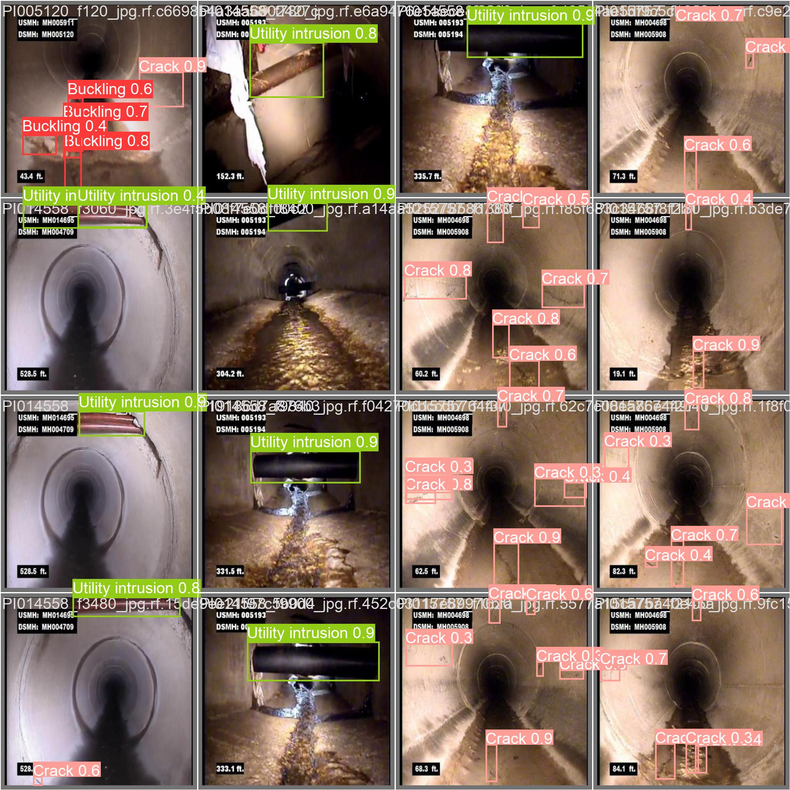
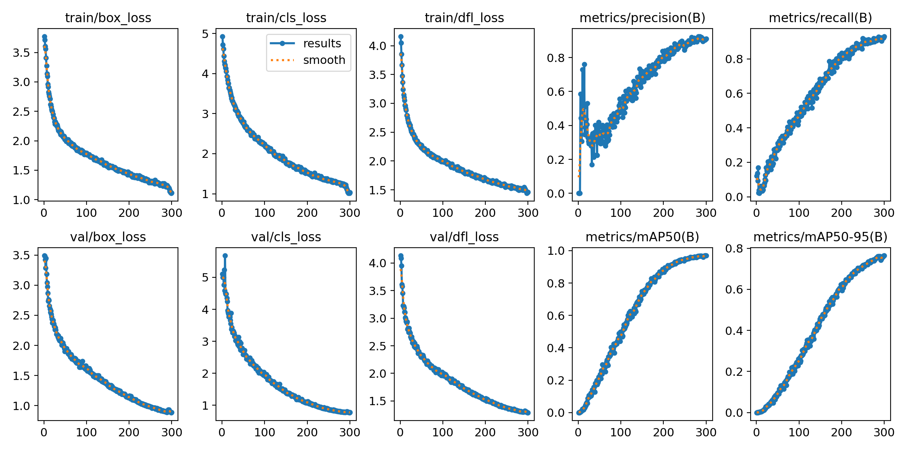

# sewer pipe defect detection with YOLOv8

A YOLOv8 object detection model that finds seven kinds of damage in sewer pipe inspection images: buckling, cracks, debris, holes, joint offsets, obstacles, and utility intrusions.

I built this in spring 2024 as a self-taught science fair project. It was the vision component of a sewer-inspection robot, meant to detect and flag damage in the robot's camera footage.



## results

I trained a YOLOv8n model for 300 epochs and scored it with mAP@0.5: mean average precision, where a detection counts as correct if its box overlaps the true box by at least 50%.

| class | training images | validation images |
| --- | --- | --- |
| Buckling | 0.938 | 0.427 |
| Crack | 0.947 | 0.375 |
| Debris | 0.983 | 0.553 |
| Hole | 0.982 | 0.364 |
| Joint offset | 0.964 | 0.198 |
| Obstacle | 0.983 | 0.558 |
| Utility intrusion | 0.987 | 0.609 |
| **all classes** | **0.969** | **0.441** |

the model nearly memorized the images it trained on but did much worse on images it had never seen. The model had started overfitting (this was my first coding project and I wasn't as familiar with the concept at the time) and the validation score is the honest measure of how the model would do in a real pipe.



## what I learned

- The model started overfitting around epoch 100. Training loss kept dropping the whole time, but validation loss hit its lowest point there and then slowly went back up. Validation mAP@0.5 stalled around 0.44, so the last 200 epochs mostly taught the model to memorize the training images instead of getting better at new ones.
- I also didn’t realize until later that I trained the model from scratch. I loaded yolov8n.yaml, which builds the network with random weights, instead of yolov8n.pt, which starts from weights already trained on the COCO dataset. With a dataset this small, starting from pretrained weights would probably help a lot, so that’s the first thing I want to try. train.py has a --pretrained option for it.
- Joint offsets gave the model the most trouble, with a validation score of 0.198. It could be that the dataset just didn’t have many examples of them. results/labels.jpg shows how many labels each class has, so that’s where I’d start to loko if I tried the project again.

## repository layout

```
├── data.yaml        dataset config: class names and image folders
├── train.py         train a model
├── validate.py      score a trained model on the train or val split
├── predict.py       detect defects in new images, video, or a live stream
├── weights/         trained weights from the 300-epoch run
└── results/         training curves, confusion matrices, and settings from that run
```

## usage

Install dependencies (Python 3.8 or newer):

```bash
pip install -r requirements.txt
```

Run the trained model on your own images, a video file, or a webcam (`--source 0`):

```bash
python predict.py --source path/to/images
```

Annotated results are saved to `runs/detect/predict*`.

To train or validate, first set `path` in `data.yaml` to your dataset folder, then:

```bash
python train.py                # reproduce the original run (from scratch, 300 epochs)
python train.py --pretrained   # start from COCO-pretrained weights instead
python validate.py --split val
```

## dataset

I used the [Sewer Defects dataset](https://universe.roboflow.com/sewage-defect-detection-s68df/sewer-defects-u8zwz) by Sewage Defect Detection on Roboflow Universe (978 labeled images, [CC BY 4.0](https://creativecommons.org/licenses/by/4.0/)). It isn't included in this repo; download it from Roboflow in YOLOv8 format. Images were split 70% for training and 30% for validation, with this folder layout:

```
sewer-dataset/
├── images/
│   ├── train/
│   └── val/
└── labels/
    ├── train/
    └── val/
```

## training settings

YOLOv8n with Ultralytics 8.1, trained from scratch for 300 epochs with batch size 16, 640-pixel images, seed 0, and Ultralytics' default augmentation (mosaic, horizontal flips, color jitter). Full settings are in [`results/args.yaml`](results/args.yaml).

## acknowledgments

built w [Ultralytics YOLOv8](https://github.com/ultralytics/ultralytics). code started from following tutorials:

- [The YouTube tutorial I followed](https://www.youtube.com/watch?v=TRMZCsBfX78) -> to build the project
- Computer Vision Engineer's [step-by-step guide to training YOLOv8 on a custom dataset](https://github.com/computervisioneng/train-yolov8-custom-dataset-step-by-step-guide), -> my training setup and Colab config are based on
- Nicolai Nielsen's "How to Train YOLOv8 Object Detection on a Custom Dataset" Colab notebook, -> my validation and prediction commands are based on

I also learned object detection basics from Nicholas Renotte's [TensorFlow Object Detection course](https://www.youtube.com/watch?v=yqkISICHH-U)
